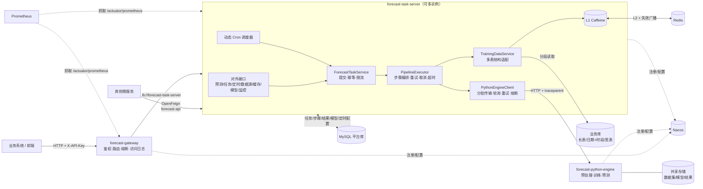
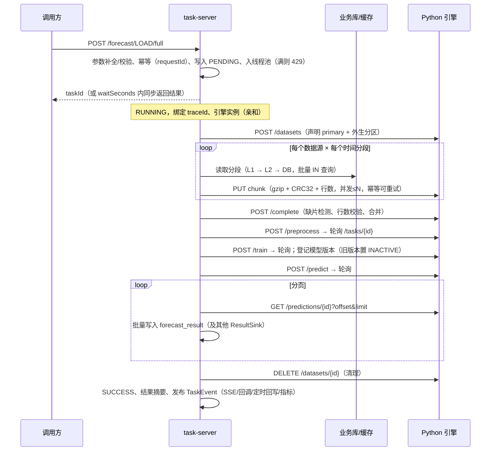

# 架构设计

## 1. 总体架构

- **接口与调度共用同一执行链路**：定时任务触发后同样走 `ForecastTaskService.submit`，处理过程、记录、监控完全一致。
- **服务无状态**：任务状态、定时配置、触发记录全部在数据库；本地状态（运行中任务、L1 缓存）可丢失，宕机由心跳回收兜底。

## 2. 一次一体化预测（FULL）的执行过程

## 3. 流程编排（可扩展）

| 概念 | 说明 |
|---|---|
| `ForecastStep` | 步骤扩展点：`name()`、`shouldSkip(ctx)`、`retryable()`、`execute(ctx)` |
| `PipelineContext` | 请求参数（已补全）、步骤间产物（datasetId/modelId/predictionId…）、取消标记、截止时间、进度汇报、清理动作 |
| `forecast.pipelines` | 流程名 → 模式 → 有序步骤名；启动时校验步骤是否存在 |
| `forecast.task-types` | 任务类型 → 数据源、目标、默认窗口、算法参数、引用的流程 |

内置步骤：`LOAD_DATA`（取数 + 分批传输）、`PREPROCESS`、`TRAIN`（含模型登记）、`PREDICT`、`PERSIST_RESULT`。

执行器统一处理：步骤级重试（仅网络/引擎瞬时故障，业务错误不重试）、步骤边界与轮询中的取消/超时检查、
步骤轨迹落库（耗时、尝试次数、Python 任务 ID、产出）、Micrometer Observation（指标 + span）、无论成败都执行资源清理。

## 4. 不同表结构的预训练数据

数据源配置在 `forecast_data_source`，由 `LayoutHandler` 统一转换为 `(series_key, ts, fields...)`：

| 布局 | 典型表 | 关键配置 |
|---|---|---|
| `LONG_TIME` | 气象逐小时表 | `time_column`、`field_mapping={"temperature":"temp"}` |
| `DATE_PERIOD` | 出清量价（日期 + 时段号 1..96） | `date_column`、`period_column`、`points_per_day` |
| `WIDE_POINTS` | 96 点负荷宽表（p001..p096） | `date_column`、`points_per_day`、`field_mapping={"load":"p%03d"}` |

- 支持 `key_column`（预测对象）、`fixed_filters`（如只取日前价格 `{"price_type":"DA"}`）；
- 表名/列名经白名单正则校验后拼接，所有取值参数化绑定，防止 SQL 注入；
- 业务数据可放在独立库（`forecast.business-datasource.*`，只读连接池，与平台库隔离）。

## 5. 预训练数据缓存

目标：避免训练/预测频繁读库，尤其是定时任务集中触发、滚动预测反复读取近期窗口的场景。

- **分段缓存**：按“数据源 + 预测对象 + 时间分段（月/日）”缓存，任意时间窗口的请求都拆成分段读取后裁剪，相邻窗口自然复用；
- **两级**：L1 Caffeine（按行数加权淘汰，`local-max-rows`）→ L2 Redis（二进制 + gzip，多实例共享、重启不失效）→ 数据库；
- **防击穿**：Caffeine AsyncCache 合并同一分段的并发加载；缺失分段批量 `IN` 查询；空分段同样缓存；
- **时效**：近期分段（`hot-window` 内，可能仍有补录）短 TTL，历史分段长 TTL；
- **失效**：`POST /api/v1/cache/evict` 按数据源/日期范围失效，并通过 Redis Pub/Sub 广播到所有实例；
- **内存可控**：读取按分段流式回调，传输按分片发送，内存占用与分段/分片大小相关，与总窗口长度无关；
- **降级**：Redis 异常一律视为未命中，不影响任务。

## 6. 分批传输协议

| 机制 | 说明 |
|---|---|
| 分片 | 固定行数（`transfer.chunk-rows`），列式 JSON，gzip 压缩 |
| 完整性 | 每片携带 CRC32 与行数，引擎校验；`complete` 时检测缺片并核对总行数 |
| 幂等 | `PUT .../chunks/{seq}` 可重复上传；提交类接口带 `request_id`，引擎去重 |
| 并发与背压 | 信号量限制在途分片数（`transfer.parallelism`），读取线程在上传积压时阻塞 |
| 实例亲和 | 一次任务的数据集、预处理结果、模型位于同一引擎实例（多副本建议共享存储） |
| 结果回传 | 预测结果分页拉取，大结果集同样分批 |

## 7. 定时调度

- `ForecastJobScheduler` 启动时及每个刷新周期从数据库加载配置，配置指纹（cron/时区/启用）变化即重新注册；
- 按 Cron 精确计算“下一次触发时间”后单次调度，触发后先排下一次再执行，所有节点计算出的触发点一致；
- **集群去重**：插入 `forecast_job_fire_log`，唯一键 `(job_id, fire_time, attempt)` 冲突即表示其他节点已触发；同时 `requestId=JOB-{id}-{fireTime}-{attempt}` 作为任务幂等的第二道保护；
- **并发策略** `SKIP/ALLOW`、**错过补偿** `IGNORE/FIRE_ONCE`、**失败重试** `max_retries/retry_interval_seconds`；
- 任务结束事件回写触发记录与 `last_status`，结果由流程中的 `PERSIST_RESULT` 入库。

## 8. 可靠性

| 风险 | 措施 |
|---|---|
| 过载 | 有界线程池 + 拒绝即返回 429；数据传输、回调使用独立线程池 |
| 引擎抖动 | Resilience4j 指数退避重试（仅瞬时故障）+ 熔断；步骤级重试兜底 |
| 引擎长任务 | 异步提交 + 退避轮询，不受 HTTP 超时限制；取消/超时时通知引擎取消 |
| 重复提交 | `requestId` 唯一索引；引擎侧 `request_id` 去重 |
| 节点宕机 | 活动任务每 30s 心跳；超时（默认 5 分钟）由任意节点回收为 FAILED 并触发定时任务重试；节点重启时回收本节点遗留任务 |
| 跨节点取消 | 取消请求写库，执行节点定期感知并中止 |
| 任务超时 | 按任务类型/请求配置截止时间，步骤与轮询中检查 |
| 并发更新 | 状态流转均为带前置状态的条件更新；定时配置乐观锁 |
| 停机 | 优雅停机，等待运行中任务（`await-termination-seconds`） |
| 安全 | API Key（常量时间比较）、回调地址白名单（防 SSRF）、标识符白名单（防注入）、服务间令牌、Actuator 最小暴露 |

## 9. 监控与追踪

- **任务级追踪**：`forecast_task_instance` 记录状态、进度、当前步骤、触发方式、traceId、执行节点、引擎实例、请求参数、结果摘要、错误；`forecast_task_step` 记录每个步骤每次尝试；
- **链路**：Micrometer Tracing 为每个任务创建 `forecast.task` span（父级为提交请求），步骤为子 span；traceId 写入日志 MDC 并通过 `traceparent`/`X-Trace-Id`/`X-Task-Id` 透传给 Python 引擎，两侧日志可按 traceId 串联；接入 Zipkin/Tempo 只需引入对应 reporter；
- **指标**：`forecast_task_seconds{task_type,mode,status,trigger}`、`forecast_task_step_seconds{step}`、`forecast_task_submitted/finished_total`、`forecast_task_running/queued`、`forecast_engine_calls_seconds{operation,outcome}`、`forecast_transfer_bytes/chunks_total`、`forecast_cache_*`、`cache_gets{forecast_data_segment}`、`executor_*`、Resilience4j 熔断/重试指标；
- **实时**：`GET /api/v1/tasks/{id}/stream`（SSE）推送步骤切换与引擎侧进度；
- **总览**：`GET /api/v1/monitor/overview`；告警规则示例 `deploy/alert-rules.yml`。

## 10. 数据模型

| 表 | 说明 |
|---|---|
| `forecast_task_instance` | 任务实例（唯一：task_id、request_id） |
| `forecast_task_step` | 步骤执行轨迹 |
| `forecast_result` | 预测结果（series_key、target_field、forecast_time、value、上下界、model_id） |
| `forecast_model` | 模型注册表（算法、覆盖对象、目标、训练窗口、指标、ACTIVE/INACTIVE、所在引擎实例） |
| `forecast_job_config` | 定时任务配置 |
| `forecast_job_fire_log` | 触发记录（集群去重唯一键） |
| `forecast_data_source` | 预训练数据源配置 |

Schema 由 Flyway 管理（`db/migration`），演示表与演示数据在 `db/demo`（仅演示环境加载）。

## 11. 性能调优参考

| 参数 | 默认 | 说明 |
|---|---|---|
| `forecast.executor.core/max-pool-size`、`queue-capacity` | 8/16/200 | 并发任务数，受 Python 引擎算力约束 |
| `forecast.transfer.chunk-rows` / `parallelism` | 20000 / 2 | 单片约 1~2MB（gzip 后），增大并行度可提高带宽利用 |
| `forecast.cache.local-max-rows` | 500 万 | 约 0.3~0.5GB 堆内存，按 JVM 内存调整 |
| `forecast.cache.history-ttl` / `hot-ttl` / `hot-window` | 12h / 5m / 3d | 数据补录频繁时缩短 hot-ttl 或调用失效接口 |
| `forecast.engine.poll-*` | 500ms~2s | 轮询退避区间 |
| `ENGINE_WORKERS` | 4 | Python 并发任务数，建议 ≤ CPU 核数 |
| MySQL URL | `rewriteBatchedStatements=true&useCursorFetch=true` | 批量写入与流式读取 |
